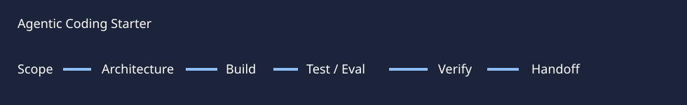

# Agentic Coding Starter

A portable engineering starter for Codex and compatible coding agents. It turns a request into a verifiable handoff with explicit status language.

## Quick start

Copy [`templates/AGENTS.md`](templates/AGENTS.md) into a new repository and edit scope and commands. Fill [`templates/PROJECT_PLAN.md`](templates/PROJECT_PLAN.md) before broad changes and [`templates/HANDOFF.md`](templates/HANDOFF.md) at the end. Run `python3 tests/validate.py` to check required status vocabulary.

## Problem and architecture

Scope → architecture → acceptance criteria → implementation → tests → eval when AI behavior changes → secret/dependency scan → external verification → status → handoff. The templates make each stage inspectable and prevent local success from being described as live integration proof. See [Definition of Done](docs/definition-of-done.md).

## Status language

`IMPLEMENTED_AND_TESTED`, `IMPLEMENTED_NOT_EXTERNAL_VERIFIED`, `MOCK`, `BLOCKED_EXTERNAL`, `DEFERRED_BY_SCOPE`, `NOT_IMPLEMENTED`. Use the narrowest truthful state per feature. See [examples](examples/sample-handoff.md).

## Verification / limitations

The validator checks template coverage only. It does not certify a product, evaluate a model or scan a repository for actual secrets. Users must run project-specific tests and inspect external behavior. MIT.
